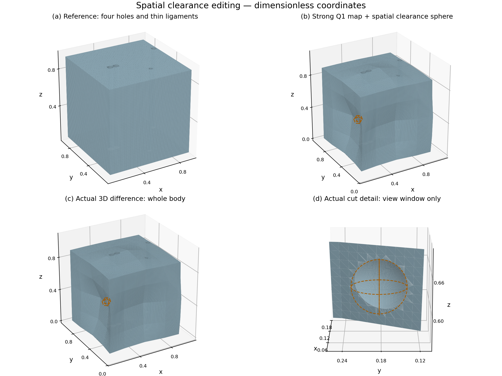

# DeformSolid

Nonlinear solid modeling with inverse-implicit queries, 3D Boolean editing,
cross-section inspection, and a native C++ numerical engine.

**[Live application](https://danielye.net/projects/deform-solid/)** ·
**[Daniel Ye](https://danielye.net/)**



## What it does

- Represents a four-hole solid analytically and maps it through a piecewise-Q1 deformation.
- Evaluates the deformed implicit field through damped Newton inversion.
- Constructs actual 3D differences with Manifold, including a transported cutting tool.
- Extracts ordered cross-sections and compares surface, contour, volume, and feature behavior.
- Runs dense double-precision field queries in native C++, through a versioned structure-of-arrays C ABI.

**GPU update:** the CUDA backend is in development. The current release includes
the native C++ CPU evaluator and its batch interface.

## Run the geometry example

Clone this repository, then work from `_code/deform-solid/`:

```sh
python -m venv .venv
# Activate the environment, then:
python -m pip install -r requirements.txt
python -B examples/build_geometry.py --output output
```

The example writes reference/deformed/A/B/C meshes in OBJ and PLY, ordered
sections in JSON/CSV/GeoJSON/SVG, and `results.json`. Open the meshes in MeshLab
or another OBJ/PLY viewer. Output directories must be new.

The implementation reuses the project's geometry, Q1, Newton, section, and
Boolean modules; the public example is a small entry point into those modules.

## Native C++ batch evaluation

Requires CMake 3.20+, a C++17 compiler, and Python with the requirements above.
From this directory, with a native compiler configured:

```sh
cmake -S course_project/gpu/e1 -B build -DCMAKE_BUILD_TYPE=Release
cmake --build build --config Release
python -B course_project/gpu/e1/evaluate.py --library build/e1_native.dll --n 1024 --output dense.npz
python -B tests/test_native_release.py --library build/e1_native.dll
```

For a multi-configuration Windows generator, use `build/Release/e1_native.dll`.
On Linux/macOS use the generated `.so`/`.dylib` path with `--library`.
The released numerical implementation was executed with native Windows Clang
17/LLD. `build.py` and `toolchain/windows-clang.cmake` retain that build path;
pass local CMake, Ninja, and LLVM paths explicitly when using it.

The kernel is in `course_project/gpu/e1/src/evaluator.cpp`; the C ABI is in
`include/e1.h`, and `native.py` makes one ctypes call per batch. Caller-owned
buffers report field values, source coordinates, inverse residuals, and per-row
status. See [INTERFACE.md](course_project/gpu/e1/INTERFACE.md).

## Measured results

For the strong four-hole case at 2048² cells, the recorded native CPU median is
0.8514 s versus 6.1203 s for the Python reference, or 7.19×. Throughput is about
4.93 million nodes/s. Measurements use one warmup and five timed repetitions,
with single-thread execution. Native compute excludes allocation and interop;
the Python reference includes its existing chunked evaluation work.

Across the six dense cases, 11,024,390 nodes were compared. The largest field
gap against Python/saved values is 9.521e-15, with no numerical-status or sign
mismatches on those grids. Raw CPU timings and parity results are in
[`results/native/`](results/native/).

The fine transported-tool A/C comparison has sampled surface distance
6.56327e-5 and absolute volume error 7.88695e-7. All eighteen inspected mesh
sections retain four holes. The live page links the geometry tables and also
shows a small-hole resolution failure and its feature-aware recovery.

## Layout

```text
solid_modeling/                  analytic CSG, deformation, sections, meshing
experiments/                    original Q1/Newton and Boolean support modules
solid-query/                    original structured-map dependencies
course_project/gpu/e1/          native C++17 engine and CMake configuration
examples/build_geometry.py     reproducible modeling application example
tests/test_native_release.py    native/reference tests for this distribution
results/native/                measured CPU and numerical results
```

The website source is at [`projects/deform-solid/`](../../projects/deform-solid/)
in the repository root. Its WebGL viewer displays exported meshes; numerical
modeling runs in Python/C++. Float32 browser display buffers are separate from
the double-precision numerical engine and OBJ exports.
